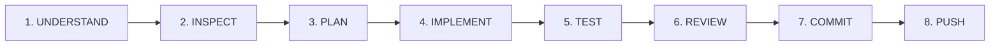

# AI Coding Agent Directives & Engineering Standards (AGENTS.md)

This document defines the **mandatory operational directives, engineering constraints, and workflow protocols** for all AI coding agents (including Google Antigravity, Claude Code, OpenAI Codex, Cursor, and custom LLM assistants) contributing to the **Handloom Operations Management Platform**.

Compliance with these rules is strictly enforced across all development phases.

---

## 1. Core Principles

The Handloom platform is a real-world, enterprise-grade multi-tenant production system managing physical material supply chains, artisan livelihoods, and financial accounting. **It is not a demo, prototype, or sandbox for experimental rewrites.**

1. **Production Reliability Over Novelty:** Always prefer battle-tested, standard patterns over clever or non-standard abstractions.
2. **Deterministic Data Integrity:** Inventory transactions, cut-piece reconciliations, wage approvals, and advance debits represent real physical assets and monetary values. Financial/inventory inconsistencies cannot be tolerated.
3. **Defense in Depth:** Every boundary (network, API, domain service, database) must validate and enforce authorization independently.

---

## 2. The 20 Mandatory Rules for AI Agents

All AI agents operating in this repository must strictly adhere to the following rules:

1. **Inspect Existing Code Before Editing:** Never assume directory structure, package versions, or implementations. Always inspect files, package manifests, and configurations prior to proposing or executing edits.
2. **Preserve Existing Working Functionality:** Never break, degrade, or delete working features, tests, or configurations unless explicitly instructed with clear deprecation rationale.
3. **Never Rewrite the Entire Project Unnecessarily:** Make surgical, targeted modifications. Do not replace an entire module or rewrite working packages when incremental extension is sufficient.
4. **Follow Established Architecture & Module Boundaries:** Respect the Turborepo monorepo separation (`apps/web`, `apps/api`, `packages/database`, `packages/types`, `packages/config`, `packages/logger`). Never cross domain boundaries without defined interfaces.
5. **Use TypeScript Strict Mode:** Maintain `strict: true` across all packages. Never use `any` unless explicitly justified in comments for low-level library shims. Ensure all types are explicitly exported via `@handloom/types`.
6. **Validate All External Inputs:** Every incoming request body, query parameter, route parameter, and file payload must be validated via class-validator DTOs or Zod schemas. Strip unknown properties using `whitelist: true` and `forbidNonWhitelisted: true`.
7. **Use Backend Authorization for Protected Operations:** Every mutating or tenant-scoped endpoint must be guarded by `JwtAuthGuard` and `RolesGuard`. Role requirements (`@Roles(...)`) must be enforced at the controller and service layers.
8. **Never Trust Frontend Permission Checks Alone:** Frontend UI role hiding is solely for user experience. The backend API is the ultimate authority and must strictly enforce tenant and role isolation on every request.
9. **Never Expose Secrets:** Never log, output, hardcode, or commit passwords, API keys, private keys, database connection strings, or JWT secrets. Use environment variables with `.env.example` templates.
10. **Never Fabricate API Responses or Production Data:** Never generate synthetic or hallucinated mock success strings when a command or test fails. Always report actual command execution outputs and exit codes truthfully.
11. **Never Silently Modify Database Migrations:** Existing applied database migrations must never be altered or deleted. All schema evolutions must be performed via forward-only versioned migrations.
12. **Review All Database Schema Changes:** Ensure every schema change maintains foreign keys, appropriate cascading/restrict behaviors, multi-tenant indexes (`tenantId`), and proper data types (`Decimal` for money and weight, not floating-point).
13. **Use Database Transactions for Critical Business Operations:** Multi-table writes (such as yarn lot issue + stock ledger entry, or weaver cut-piece acceptance + wage ledger credit) must execute within atomic database transactions (`prisma.$transaction`).
14. **Implement Idempotency for Critical Commands:** APIs performing material dispatch, financial disbursement, or payment batching must support idempotency keys to prevent duplicate execution upon network retries.
15. **Maintain Tenant Isolation:** Ensure every query is tenant-scoped. Super-admin queries must use dedicated, auditable scopes. Utilize PostgreSQL Row-Level Security (RLS) contexts (`withTenantContext`) for tenant boundaries.
16. **Write Meaningful Tests:** Every new endpoint, service method, and business calculation must include unit tests and, where applicable, integration/e2e tests covering both happy paths and edge cases (e.g., negative stock, unauthorized tenant access).
17. **Run Relevant Builds and Tests After Implementation:** Never complete a task without executing the typecheck, unit tests, and build locally (`pnpm typecheck`, `pnpm test`, `pnpm build`).
18. **Review Git Diffs Before Committing:** Run `git status` and `git diff` before creating commits. Never stage build artifacts (`dist/`, `.next/`), local logs, temporary scratch files, or unverified files.
19. **Never Force Push:** Never run `git push --force` or `git push -f` to remote branches. All collaborative history must be preserved.
20. **Never Deploy to Production Without Authorization:** Deployment to staging or production environments requires explicit human review and approved CI/CD workflows.

---

## 3. Mandatory Task Execution Workflow

AI agents must execute all tasks following the sequential eight-stage lifecycle:

### Stage 1: UNDERSTAND

- Read and deconstruct the user prompt or task specification.
- Identify exact requirements, domain scope, non-functional criteria, and operational constraints.

### Stage 2: INSPECT

- Examine existing source files, package manifests (`package.json`), database models (`schema.prisma`), and configs.
- Confirm current Git branch status (`git status`, `git log -n 5`).
- Determine existing patterns, naming conventions, and shared package utilities.

### Stage 3: PLAN

- Formulate an implementation strategy detailing affected files, database schema impact, new DTOs, service methods, controllers, and tests.
- Verify backward compatibility with existing modules.

### Stage 4: IMPLEMENT

- Make surgical, targeted code modifications.
- Adhere to established project styling, strict typing, error handling, and structured logging.
- Maintain documentation integrity and preserve unrelated existing code comments.

### Stage 5: TEST

- Execute local verification commands:
  - `pnpm typecheck`: Ensure zero type errors across all workspaces.
  - `pnpm test`: Run unit and service test suites.
  - `pnpm test:e2e`: Run live API end-to-end suites.
  - `pnpm build`: Verify successful compilation of all packages and applications.

### Stage 6: REVIEW

- Execute `git status` and `git diff` to inspect every staged modification.
- Verify no credentials, debug logs, or unwanted artifacts are present.
- Confirm alignment with the original task specification.

### Stage 7: COMMIT

- Format commit message using Conventional Commits (`feat(...)`, `fix(...)`, `docs(...)`, `test(...)`, `chore(...)`).
- Stage only intended files.

### Stage 8: PUSH

- Push the commit to the designated upstream branch (`origin <branch>`).
- Verify successful push output from Git.

---

## 4. Agent Reporting Standards

Upon completion of any implementation or maintenance turn, the AI agent must provide a structured final report detailing:

1. **Files Modified/Created:** Exact paths to all modified or created files with brief functional descriptions.
2. **Commands Executed:** The exact build, test, and verification commands executed locally.
3. **Actual Results:** Raw summary of test pass counts, build durations, and diagnostic status (never synthetic or assumed results).
4. **Git Metadata:** Commit hash, commit message, and branch push confirmation.
5. **Unresolved Issues / Next Steps:** Any discovered bugs, technical debt, or recommended subsequent tasks.
