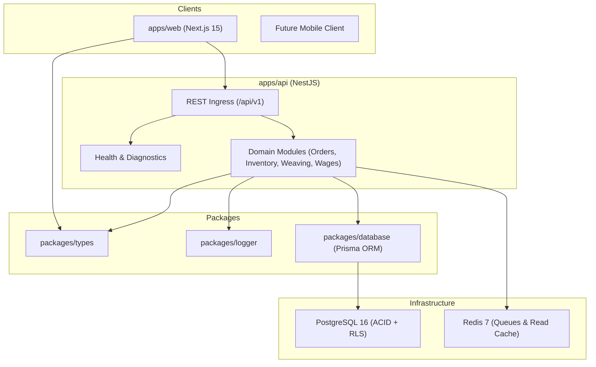

# Handloom Platform Architecture & Engineering Blueprint

## 1. System Context & Concurrency Goals

* **Target Capacity:** 1,000–10,000 concurrent active users (supervisors, weaver cooperatives, administrative accountants).
* **System Type:** High-concurrency, multi-tenant Operations & Resource Planning (ERP) platform.
* **Core Tenet:** Strict transactional consistency for physical inventory (yarn/silk lots) and worker wages (piece rates, advances).

---

## 2. Monorepo Separation of Concerns

---

## 3. High-Concurrency Scaling Roadmap

1. **Connection Pooling:**
   * Direct PostgreSQL connections under high concurrency trigger resource exhaustion.
   * Target deployment utilizes PgBouncer or AWS RDS Proxy with strict pool sizing (100–200 server connections).
2. **Asynchronous Background Processing:**
   * High-latency operations (OCR processing of physical weaver books, warp requirement calculation, wage batching) are delegated to Redis-backed BullMQ workers.
3. **Database Concurrency & Inventory Locking:**
   * Inventory allocations will use atomic ledger inserts with optimistic locking (`version` field) to avoid hot-row lock contention across high-throughput looms.
4. **Multi-Tenant Isolation:**
   * Data segregation is enforced at the database level utilizing PostgreSQL Row-Level Security (RLS) linked to the active session `tenant_id`.

