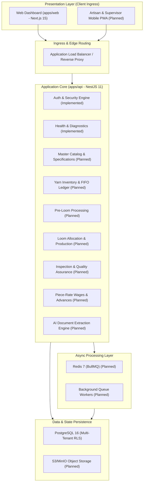

# Handloom Platform Architecture & System Design (docs/ARCHITECTURE.md)

## 1. Executive Architecture Summary

The **Handloom Operations Management Platform** is architected as an **Enterprise Modular Monolith** designed for high transactional integrity, horizontal scalability, and strict multi-tenant isolation. It manages the end-to-end handloom production lifecycle across cooperative societies, master weaver clusters, and independent textile mills.

### Engineering Concurrency Targets

- **Target Concurrency:** 1,000 to 10,000 concurrent active users (supervisors, weavers, master weavers, society administrators, inspectors, and accounts personnel).
- **Architecture Paradigm:** Stateless API instances backed by partitioned PostgreSQL with connection pooling, Redis caching/queues, and React/Next.js edge-ready frontend clients.
- **Architectural Style:** Modular Monolith (domain boundaries enforced through internal modules; microservices avoided to eliminate distributed transaction overhead on financial and inventory ledgers).

---

## 2. High-Level Component Topology



---

## 3. Implementation Status Matrix

| Component / Layer           | Module / Package                      | Current Status  | Description                                                                                                     |
| :-------------------------- | :------------------------------------ | :-------------- | :-------------------------------------------------------------------------------------------------------------- |
| **Monorepo Build**          | Turborepo / pnpm                      | **IMPLEMENTED** | Turborepo 2.11, pnpm workspaces, TypeScript strict mode across all packages.                                    |
| **Presentation Tier**       | `apps/web`                            | **IMPLEMENTED** | Next.js 15.5 App Router, React 19, Tailwind CSS 3.4, Lucide icons, responsive dashboard.                        |
| **Core API Gateway**        | `apps/api`                            | **IMPLEMENTED** | NestJS 11, global validation pipe, HttpExceptionFilter, TransformInterceptor, OpenAPI/Swagger.                  |
| **Authentication Engine**   | `apps/api/src/modules/auth`           | **IMPLEMENTED** | Multi-tenant auth, bcryptjs hashing, JWT access/refresh rotation, RBAC guards (`JwtAuthGuard`, `RolesGuard`).   |
| **Diagnostics & Health**    | `apps/api/src/modules/health`         | **IMPLEMENTED** | `/api/v1/health` endpoint reporting uptime, service status, and database probe.                                 |
| **Tenant Isolation Engine** | `packages/database`                   | **IMPLEMENTED** | Schema models (`Tenant`, `User`, `Session`, `AuditLog`, `SystemHealth`), RLS SQL policies, `withTenantContext`. |
| **Shared Logging**          | `packages/logger`                     | **IMPLEMENTED** | Structured Pino JSON logger with sensitive credential and header redaction.                                     |
| **Shared Types**            | `packages/types`                      | **IMPLEMENTED** | Canonical domain types, role enums, tenant enums, and API response contracts.                                   |
| **Master Catalog**          | `apps/api/src/modules/catalog`        | **PLANNED**     | Product designs, reed/pick specifications, warp/weft requirements, Bill of Materials (BOM).                     |
| **Yarn Inventory**          | `apps/api/src/modules/yarn-inventory` | **PLANNED**     | Yarn items, procurement lots, stock ledger, FIFO allocations, and scrap tracking.                               |
| **Pre-Loom Workflows**      | `apps/api/src/modules/pre-loom`       | **PLANNED**     | Bobbin winding, warping, beaming, sizing, hank dyeing, and loss reconciliation.                                 |
| **Loom Operations**         | `apps/api/src/modules/production`     | **PLANNED**     | Weaver assignments, warp beam loading, loom card tracking, cut-piece receipt.                                   |
| **Quality & Inspection**    | `apps/api/src/modules/quality`        | **PLANNED**     | Quality checks, defect grading (A/B/C), half-rate damage deduction, rework slips.                               |
| **Wages & Financials**      | `apps/api/src/modules/wages`          | **PLANNED**     | Piece-rate calculations, weekly settlement batches, advance deductions, ledger balance.                         |
| **AI Document Assist**      | `apps/api/src/modules/ai`             | **PLANNED**     | OCR invoice parsing, physical weaver passbook extraction, discrepancy detection.                                |
| **Background Queues**       | BullMQ + Redis                        | **PLANNED**     | High-latency wage settlement batching, PDF invoice generation, async audit exports.                             |
| **Object Storage**          | S3 / MinIO                            | **PLANNED**     | Fabric CAD files, artisan photographs, defect imagery, signed wage receipts.                                    |
| **Container Engine**        | `docker/docker-compose.yml`           | **UNVERIFIED**  | Docker Compose manifest present; host daemon verification pending in local environment.                         |

---

## 4. Frontend & Backend Boundaries

### Frontend Boundary (`apps/web`)

- **Technology:** Next.js 15 (App Router), React 19, TypeScript strict mode.
- **Responsibilities:**
  - Rendering responsive UI views for desktop supervisors and tablet/mobile field staff.
  - Client-side navigation, form rendering, and local optimistic updates.
  - Server state caching and revalidation via TanStack Query.
- **Strict Boundary Constraint:** The frontend contains **zero business calculations** for inventory balances, quality deductions, or wage amounts. The frontend displays data received from the API and submits actions for authoritative server validation.

### Backend Boundary (`apps/api`)

- **Technology:** NestJS 11, Node.js 22 LTS, Express adapter, TypeScript strict mode.
- **Responsibilities:**
  - Authoritative validation of all payloads via class-validator DTOs.
  - Authentication, cryptographic session rotation, and RBAC authorization enforcement.
  - Execution of ACID transactional workflows.
  - Emitting structured JSON audit trails for compliance.
- **Stateless Principle:** No in-memory sessions or global request state. Every request carries an authenticated JWT payload; state is persisted exclusively in PostgreSQL and Redis.

---

## 5. Domain Module Architecture (Modular Monolith)

To preserve transactional consistency while maintaining clean codebase boundaries, the backend is organized into encapsulated domain modules:

```text
apps/api/src/modules/
├── auth/              # Tenant registration, JWT authentication, session revocation (IMPLEMENTED)
├── health/            # Liveness, readiness, and dependency health checks (IMPLEMENTED)
├── catalog/           # Products, reed/picks, warp/weft requirements, BOM (PLANNED)
├── yarn-inventory/    # Suppliers, yarn lots, FIFO allocations, stock ledger (PLANNED)
├── pre-loom/          # Winding, warping, beaming, sizing, hank dyeing (PLANNED)
├── production/        # Loom assignments, warp loading, cut-piece tracking (PLANNED)
├── quality/           # Quality grading, defect deductions, rework workflows (PLANNED)
├── wages/             # Piece rates, advance management, wage disbursements (PLANNED)
├── customer-orders/   # Order intake, production progress, dispatch (PLANNED)
└── ai/                # Document OCR extraction and automated assistance (PLANNED)
```

Each module exposes:

- **Controllers:** REST endpoints with OpenAPI documentation and route decorators.
- **Services:** Business logic, transactional operations, and event emissions.
- **DTOs:** Request/response schemas enforcing strict validation rules.
- **Unit & Integration Tests:** Comprehensive test coverage validating edge cases.

---

## 6. Database Layer & Multi-Tenant Strategy

### Database Engine

- **Engine:** PostgreSQL 16.
- **ORM Client:** Prisma ORM 6.
- **Identifiers:** Globally unique UUIDv4 (`@id @default(uuid())`) across all domain entities.

### Multi-Tenant Isolation Model

The platform adopts a **shared database, shared schema with tenant discriminator and Row-Level Security (RLS)** architecture:

1. Every domain table contains a `tenant_id` foreign key referencing the `tenants` table.
2. PostgreSQL RLS policies enforce that transactions can only read and write records where `tenant_id = current_setting('app.current_tenant_id')`.
3. Application queries utilize the transactional context runner `withTenantContext(tenantId, tx => ...)` defined in `packages/database/src/tenant.ts`.

---

## 7. Caching & Background Processing Strategy (PLANNED)

### Read Caching (Redis 7)

- **Use Case:** High-read, low-write lookups (product specifications, reed/pick charts, society metadata).
- **Invalidation:** Cache-aside pattern with explicit invalidation upon mutating operations.
- **Key Namespacing:** `handloom:{tenantId}:{entity}:{id}`.

### Background Queue Processing (BullMQ)

- **Use Case:** Async operations that exceed the standard 500ms API response budget:
  - Weekly bulk wage settlement computations.
  - Bulk PDF generation (weaver wage slips, material gate passes).
  - AI document OCR processing and visual defect inspection.
- **Reliability:** Queues configured with exponential backoff (3 retries) and a Dead-Letter Queue (DLQ) for unrecoverable errors.

---

## 8. Horizontal Scalability Roadmap (Target: 1,000–10,000 Users)

1. **Stateless API Scaling:** Deploy multiple containerized NestJS API replicas behind an Application Load Balancer with round-robin traffic distribution.
2. **Database Connection Pooling:** Utilize PgBouncer / AWS RDS Proxy to multiplex thousands of client connections into a controlled pool (100–200 server connections), avoiding PostgreSQL process exhaustion.
3. **Optimistic Concurrency on Hot Rows:** Physical inventory lots and ledger balances use optimistic locking or atomic increment/decrement queries (`UPDATE yarn_lots SET available_kg = available_kg - $1 WHERE id = $2 AND available_kg >= $1`) to eliminate deadlock risks.
4. **Read/Write Replica Splitting:** Complex reporting, historical audits, and dashboard summaries are routed to PostgreSQL read replicas.
