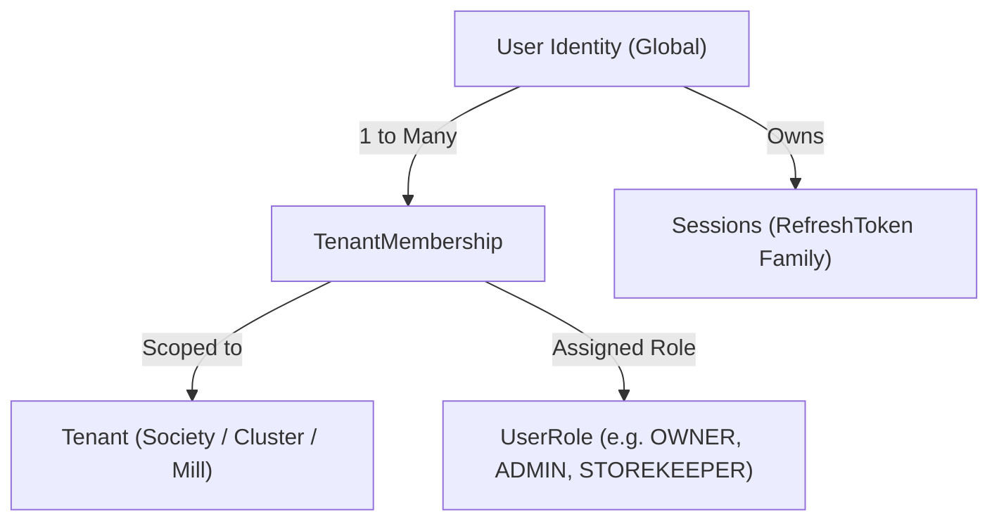
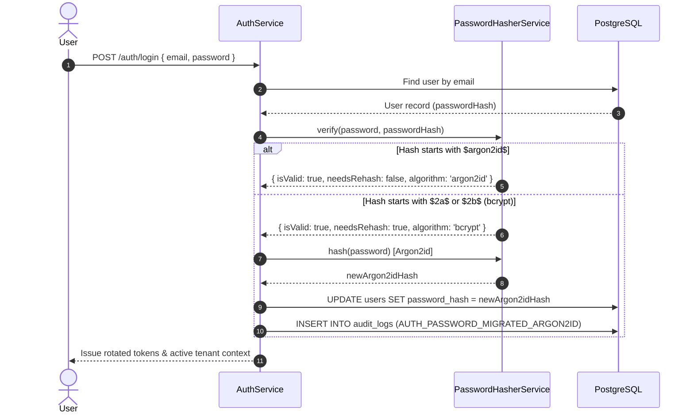

# Authentication Architecture & Implementation (docs/AUTHENTICATION.md)

## 1. Executive Summary

The Handloom Operations Management Platform enforces enterprise-grade authentication combining:
- **Argon2id** password hashing as the primary cryptographic standard with seamless, transparent migration from legacy **bcrypt** hashes.
- **Short-lived signed JWT access tokens** (15-minute default) for stateless API request authentication.
- **Cryptographically rotated refresh tokens** stored strictly as SHA-256 hashes in PostgreSQL, backed by **family-based reuse detection** that immediately revokes all compromised tokens in the event of replay attacks.
- **HttpOnly, Secure, SameSite** cookie handling for web sessions alongside standard Bearer token authorization for programmatic consumers.
- **Decoupled User Identity & Tenant Membership Architecture**: Authentication is global and decoupled from tenant-specific authorizations.

---

## 2. Global Identity vs. Tenant Membership

Authentication and authorization are strictly decoupled:

1. **User Identity:** Global entity holding primary login credentials (`email`, `passwordHash`, `firstName`, `lastName`, `status`). A user's email is unique across the entire platform.
2. **Tenant Membership:** Junction entity (`tenant_memberships`) linking a user to a specific cooperative society, mill, or cluster with an assigned role (`UserRole`) and membership status.
3. **Multi-Society Access:** A user belonging to multiple societies can seamlessly switch active tenant contexts via `POST /api/v1/auth/select-tenant`, which issues a newly scoped access token without requiring re-authentication.

---

## 3. Password Security & Dual-Algorithm Migration

### Primary Standard: Argon2id
All new user registrations and password changes are hashed using **Argon2id** (RFC 9106) with OWASP-recommended baseline parameters:
- **Algorithm Type:** `argon2id` (resistant to both GPU/ASIC side-channel and tradeoff attacks)
- **Memory Cost (`m`):** 19,456 KiB (~19 MiB)
- **Time Cost (`t`):** 2 iterations
- **Parallelism (`p`):** 1 lane
- **Salt:** 16 bytes of cryptographically secure random entropy (generated per password)

### Transparent Legacy Bcrypt Migration
Existing users with legacy bcrypt hashes (`$2a$`, `$2b$`) are not forced into disruptive password resets. The platform executes transparent on-the-fly migration:

### Protection Against Account Enumeration
- **Generic Error Responses:** All failed login attempts return HTTP `401 Unauthorized` with the generic message `"Invalid email or password"`.
- **Constant-Time Emulation:** When an unknown email is supplied, a dummy Argon2id verification cycle is computed to prevent response-time side-channel enumeration.

---

## 4. Access Token Management

- **Format:** Signed JSON Web Token (JWT), signed with HMAC SHA-256 (`HS256`) using `JWT_SECRET`.
- **Expiration:** Short-lived (default 15 minutes / 900 seconds), configured via `JWT_EXPIRES_IN`.
- **Token Claims (`JwtPayload`):**
  - `sub`: User UUID
  - `email`: User login email
  - `tenantId`: Active tenant context UUID
  - `role`: Role within the active tenant (e.g. `OWNER`, `ADMIN`)
  - `permissions`: Resolved array of granular domain permissions
  - `type`: Must equal `'access'`
  - `iat`, `exp`: Issued-at and expiration timestamps

---

## 5. Refresh Token Security & Family-Based Rotation

### Storage and Generation
- Refresh tokens are generated as 40 bytes of cryptographically secure pseudorandom entropy (`crypto.randomBytes(40).toString('hex')`).
- Plaintext refresh tokens are **never stored in the database**. The database stores only the SHA-256 hash (`crypto.createHash('sha256').update(token).digest('hex')`).

### Rotation Protocol
Every call to `POST /api/v1/auth/refresh`:
1. Consumes the presented refresh token and atomically marks its session as revoked (`is_revoked = true`, `revoked_at = NOW()`).
2. Generates a new cryptographically secure refresh token.
3. Links the new session to the predecessor via `family_id` and `parent_token_hash`.
4. Issues a new access token and new refresh token within an atomic database transaction.

### Reuse Detection & Family Revocation
If an attacker attempts to replay an already-consumed (revoked) refresh token:
1. The server identifies that `session.is_revoked === true` or `session.revoked_at !== null`.
2. **Immediate Threat Response:** The entire token family (`family_id`) is instantly revoked across all active sessions (`UPDATE sessions SET is_revoked = true, revoked_at = NOW() WHERE family_id = ...`).
3. An audit security alert is generated (`AUTH_REFRESH_TOKEN_REUSE_DETECTED`).
4. HTTP `401 Unauthorized` is returned: `"Security violation: Refresh token reuse detected. Please log in again."`

---

## 6. Web & Next.js Session Security (Cookies & Headers)

For browser clients (Next.js), authentication supports dual delivery:

| Cookie Name     | Scope / Path    | Flags                                     | Expiration   | Purpose                                      |
| :-------------- | :-------------- | :---------------------------------------- | :----------- | :------------------------------------------- |
| `access_token`  | `/`             | `HttpOnly`, `SameSite=Lax`, `Secure` (prod) | 15 minutes   | Transparent Next.js API requests and SSR     |
| `refresh_token` | `/api/v1/auth`  | `HttpOnly`, `SameSite=Lax`, `Secure` (prod) | 7 days       | Scoped strictly to auth refresh/logout paths |

- **XSS Immunity:** Long-lived refresh tokens are never stored in `localStorage` or `sessionStorage` and cannot be accessed via JavaScript `document.cookie`.
- **CSRF Defense:** `SameSite=Lax` ensures cookies are not attached on cross-origin mutating requests. API requests must include standard JSON content-type and custom headers (`X-Requested-With`).

---

## 7. Authentication API Endpoints Reference

| Method     | Path                             | Auth Guard     | Description                                                         |
| :--------- | :------------------------------- | :------------- | :------------------------------------------------------------------ |
| **POST**   | `/api/v1/auth/register-society`  | None (Public)  | Onboard new cooperative society, mill, or cluster with initial root owner |
| **POST**   | `/api/v1/auth/login`             | None (Public)  | Authenticate via email/password; resolves primary tenant membership |
| **POST**   | `/api/v1/auth/refresh`           | None (Public)  | Rotate refresh token with reuse detection                           |
| **POST**   | `/api/v1/auth/logout`            | `JwtAuthGuard` | Revoke current or specific session and clear cookies                |
| **GET**    | `/api/v1/auth/me`                | `JwtAuthGuard` | Get authenticated user identity, active tenant, and permissions    |
| **GET**    | `/api/v1/auth/memberships`       | `JwtAuthGuard` | List all tenant societies accessible by the user                   |
| **POST**   | `/api/v1/auth/select-tenant`     | `JwtAuthGuard` | Switch active tenant context and issue re-scoped access token       |
| **GET**    | `/api/v1/auth/sessions`          | `JwtAuthGuard` | List all active sessions for the user                               |
| **DELETE** | `/api/v1/auth/sessions/:id`      | `JwtAuthGuard` | Revoke a specific active session                                    |
| **POST**   | `/api/v1/auth/change-password`   | `JwtAuthGuard` | Change password, rehash to Argon2id, revoke all other sessions      |
