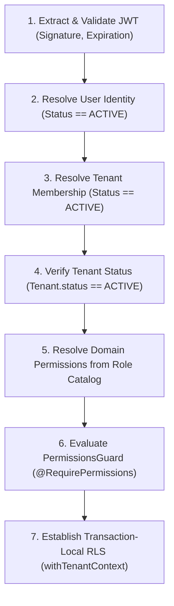

# Tenant-Aware Authorization & Role-Based Access Control (docs/AUTHORIZATION.md)

## 1. Executive Summary

Authorization in the Handloom Operations Management Platform is governed by a strict, multi-layered architecture:
1. **Server-Side Authority:** Permissions are validated exclusively on the backend. Frontend UI conditional rendering is solely for user experience.
2. **Default-Deny Model:** Endpoints decorated with permission requirements deny access unless explicit authorization is proven.
3. **Tenant-Scoped RBAC:** Permissions are granted strictly through a user's active `TenantMembership`. A user possessing `ADMIN` in Cooperative A holds zero permissions in Cooperative B.
4. **PostgreSQL Row-Level Security (RLS):** Business data queries run within transaction-local RLS contexts (`withTenantContext`), ensuring that database-level isolation guarantees cannot be bypassed even by application logic errors.

---

## 2. Server-Side Identity Resolution Pipeline

Every authenticated request undergoes a rigorous seven-stage identity pipeline:



Client-supplied headers or body parameters requesting tenant context are never trusted as proof of authorization. The tenant context is validated against verified database memberships on every request.

---

## 3. Canonical Role Hierarchy

The platform defines the following initial enterprise roles:

| Role                 | Scope & Responsibilities                                                                              | Default Permissions |
| :------------------- | :--------------------------------------------------------------------------------------------------- | :------------------ |
| **`SUPER_ADMIN`**    | Platform-level infrastructure operator. Universal operational oversight across all tenants.           | Universal (All)     |
| **`OWNER`**          | Primary cooperative society chairperson, mill owner, or cluster head. Full tenant-level authority.   | All Tenant Scoped   |
| **`ADMIN`**          | Operations manager or administrative director. Manages staff, orders, inventory, and production.     | Broad Operational   |
| **`OFFICE_STAFF`**   | Administrative clerk. Handles catalog specifications, customer orders, and basic inventory lookups.  | Clerical Scoped     |
| **`STOREKEEPER`**    | Yarn warehouse supervisor. Oversees yarn receipt, lot allocation, and physical material dispatches.  | Inventory Focused   |
| **`SUPERVISOR`**     | Production floor supervisor. Monitors loom assignments, warping/winding stages, and cut-piece delivery.| Production Focused  |
| **`WEAVER`**         | Artisan weaver. Views assigned loom orders, logged cut-pieces, and approved wage slips.              | Artisan Scoped      |
| **`QUALITY_INSPECTOR`**| Textile inspector. Inspects woven fabric, grades defects, approves cut-pieces or flags deviations. | Quality Focused     |
| **`ACCOUNTANT`**     | Finance manager. Audits piece-rate wages, approves advances, and oversees supplier payment batches.  | Financial Focused   |
| **`TRANSPORT_STAFF`**| Logistics coordinator. Tracks yarn distribution to weavers and fabric return transit.                | Logistics Scoped    |

---

## 4. Granular Domain Permission Catalog

Permissions are defined as string literals in `@handloom/types` and mapped domain-by-domain:

```typescript
export const Permission = {
  // Tenant & Organization
  TENANT_READ: 'tenant.read',
  TENANT_UPDATE: 'tenant.update',
  
  // User Management
  USERS_READ: 'users.read',
  USERS_INVITE: 'users.invite',
  USERS_UPDATE: 'users.update',
  USERS_DEACTIVATE: 'users.deactivate',
  
  // Role & Permissions
  ROLES_READ: 'roles.read',
  ROLES_ASSIGN: 'roles.assign',
  
  // Audit Trail
  AUDIT_READ: 'audit.read',
  
  // Order Management
  ORDERS_READ: 'orders.read',
  ORDERS_CREATE: 'orders.create',
  
  // Yarn & Material Inventory
  INVENTORY_READ: 'inventory.read',
  INVENTORY_ISSUE: 'inventory.issue',
  
  // Production Lifecycle
  PRODUCTION_READ: 'production.read',
  PRODUCTION_UPDATE: 'production.update',
  
  // Quality Assurance
  QUALITY_INSPECT: 'quality.inspect',
  
  // Wage Processing
  WAGES_READ: 'wages.read',
  WAGES_APPROVE: 'wages.approve',
  
  // Payments & Financials
  PAYMENTS_READ: 'payments.read',
  PAYMENTS_APPROVE: 'payments.approve',
} as const;
```

---

## 5. Role-to-Permission Mapping Matrix

| Permission               | OWNER | ADMIN | OFFICE_STAFF | STOREKEEPER | SUPERVISOR | QUALITY_INSP | ACCOUNTANT | WEAVER | TRANSPORT |
| :----------------------- | :---: | :---: | :----------: | :---------: | :--------: | :----------: | :--------: | :----: | :-------: |
| `tenant.read`            |   ✅  |   ✅  |      ✅      |             |            |              |     ✅     |        |           |
| `tenant.update`          |   ✅  |       |              |             |            |              |            |        |           |
| `users.read`             |   ✅  |   ✅  |      ✅      |             |            |              |            |        |           |
| `users.invite`           |   ✅  |   ✅  |              |             |            |              |            |        |           |
| `users.update`           |   ✅  |   ✅  |              |             |            |              |            |        |           |
| `users.deactivate`       |   ✅  |       |              |             |            |              |            |        |           |
| `roles.read`             |   ✅  |   ✅  |              |             |            |              |            |        |           |
| `roles.assign`           |   ✅  |   ✅  |              |             |            |              |            |        |           |
| `audit.read`             |   ✅  |   ✅  |              |             |            |              |     ✅     |        |           |
| `orders.read`            |   ✅  |   ✅  |      ✅      |      ✅     |            |              |     ✅     |        |     ✅    |
| `orders.create`          |   ✅  |   ✅  |      ✅      |             |            |              |            |        |           |
| `inventory.read`         |   ✅  |   ✅  |      ✅      |      ✅     |     ✅     |              |     ✅     |        |           |
| `inventory.issue`        |   ✅  |   ✅  |              |      ✅     |            |              |            |        |           |
| `production.read`        |   ✅  |   ✅  |      ✅      |      ✅     |     ✅     |      ✅      |            |   ✅   |     ✅    |
| `production.update`      |   ✅  |   ✅  |              |             |     ✅     |              |            |        |           |
| `quality.inspect`        |   ✅  |   ✅  |              |             |     ✅     |      ✅      |            |        |           |
| `wages.read`             |   ✅  |   ✅  |      ✅      |             |     ✅     |              |     ✅     |   ✅   |           |
| `wages.approve`          |   ✅  |       |              |             |            |              |     ✅     |        |           |
| `payments.read`          |   ✅  |   ✅  |              |             |            |              |     ✅     |        |           |
| `payments.approve`       |   ✅  |       |              |             |            |              |     ✅     |        |           |

---

## 6. Decorator & Guard Usage

### NestJS Controller Guarding
Controllers and endpoints specify required permissions via `@RequirePermissions(...)`:

```typescript
@UseGuards(JwtAuthGuard, PermissionsGuard)
@Controller('inventory')
export class InventoryController {
  
  @Get('stock')
  @RequirePermissions(Permission.INVENTORY_READ)
  async getStock(@CurrentUser() user: AuthenticatedUser) {
    // Guaranteed that user has Permission.INVENTORY_READ in user.tenantId
    return this.inventoryService.getStock(user.tenantId);
  }

  @Post('issue-yarn')
  @RequirePermissions(Permission.INVENTORY_ISSUE)
  async issueYarn(@CurrentUser() user: AuthenticatedUser, @Body() dto: IssueYarnDto) {
    // Guaranteed that user has Permission.INVENTORY_ISSUE in user.tenantId
    return this.inventoryService.issueYarn(user.tenantId, dto);
  }
}
```

### PostgreSQL RLS Integration
Any tenant-scoped database query must execute within the `withTenantContext` wrapper to guarantee isolation at the PostgreSQL storage engine level:

```typescript
import { withTenantContext } from '@handloom/database';

export class InventoryService {
  async issueYarn(tenantId: string, dto: IssueYarnDto) {
    return withTenantContext(tenantId, async (tx) => {
      // SET LOCAL app.current_tenant_id = tenantId
      // RLS policies on inventory, orders, and stock tables are strictly enforced
      return tx.inventoryItem.create({ data: { tenantId, ...dto } });
    });
  }
}
```
