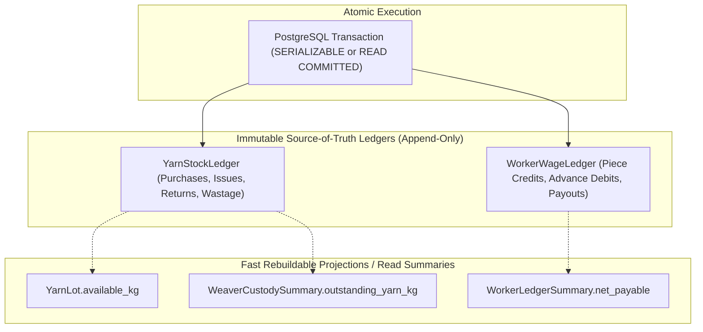

# Handloom Database Engineering Standards (docs/DATABASE.md)

## 1. Core Database Philosophy

The Handloom platform manages physical natural fiber inventories, high-value artisanal products, and worker livelihoods. The database architecture is built around **strict relational integrity, non-negotiable multi-tenant isolation, immutable event/transaction ledgers, and exact decimal arithmetic**.

Floating-point types (`float`, `double`) are **strictly prohibited** for any quantities, dimensions, weights, or currency values.

---

## 2. Technical Stack & Engine Standards

- **Database Engine:** PostgreSQL 16 (LTS).
- **ORM / Query Engine:** Prisma ORM 6.
- **Identifier Strategy:** Universally Unique Identifiers (UUIDv4) across all primary keys (`@id @default(uuid())`). No sequential integer IDs are exposed externally or used as primary keys.
- **Case Convention:**
  - Database table names: Lowercase snake_case plural (`tenants`, `users`, `yarn_lots`, `audit_logs`).
  - Column names: Lowercase snake_case (`tenant_id`, `created_at`, `password_hash`).
  - Model and field names in TypeScript/Prisma: PascalCase models, camelCase fields mapped with `@map(...)` and `@@map(...)`.

---

## 3. Data Types & Precision Standards

| Domain Attribute                                    | PostgreSQL Type  | Prisma Schema Type           | Justification                                                                   |
| :-------------------------------------------------- | :--------------- | :--------------------------- | :------------------------------------------------------------------------------ |
| **Monetary Values (Prices, Wages, Balances)**       | `NUMERIC(14, 2)` | `Decimal @db.Decimal(14, 2)` | Supports up to ₹999,999,999,999.99 without rounding or precision drift.         |
| **Material Weights (Yarn kg, Hank grams)**          | `NUMERIC(12, 3)` | `Decimal @db.Decimal(12, 3)` | Precision down to 1 gram (0.001 kg) essential for silk and zari accountability. |
| **Fabric Dimensions (Length meters, Width inches)** | `NUMERIC(8, 2)`  | `Decimal @db.Decimal(8, 2)`  | Exact fractional inches and centimeters for loom reed widths and cuts.          |
| **Percentages (Loss, Crimp, Tolerances)**           | `NUMERIC(5, 2)`  | `Decimal @db.Decimal(5, 2)`  | Exact percentage calculations (e.g., 99.99%).                                   |
| **Timestamps**                                      | `TIMESTAMPTZ`    | `DateTime`                   | Strict UTC timestamping with microsecond accuracy.                              |
| **JSON Metadata**                                   | `JSONB`          | `Json?`                      | Binary JSON for non-relational tenant configurations and audit action context.  |

---

## 4. Multi-Tenant Architecture & Row-Level Security (RLS)

### Tenant Isolation Model

Every domain table contains a mandatory `tenant_id` foreign key referencing the `tenants` table with `onDelete: Cascade`.

### Row-Level Security Strategy

1. **PostgreSQL RLS Policies:**
   - In production, PostgreSQL RLS is enabled on all tenant-partitioned tables (`ALTER TABLE ... ENABLE ROW LEVEL SECURITY`).
   - The security policy restricts row visibility:
     ```sql
     CREATE POLICY tenant_isolation_policy ON users
       FOR ALL
       USING (tenant_id = current_setting('app.current_tenant_id', true));
     ```
2. **Transactional Session Variable Injection:**
   - Database operations pass through the helper utility `withTenantContext(tenantId, tx => ...)` (`packages/database/src/tenant.ts`).
   - This sets the transaction-local PostgreSQL session setting:
     ```sql
     SET LOCAL app.current_tenant_id = 'tenant-uuid';
     ```
3. **Implementation Status:**
   - RLS schema policies script: **IMPLEMENTED** in `packages/database/prisma/rls.sql`.
   - Context runner: **IMPLEMENTED** in `packages/database/src/tenant.ts`.
   - Production Database Enforcement: **PLANNED** for initial migration execution against live PostgreSQL instances.

---

## 5. Ledger Architecture: Source of Truth vs. Summary Projections



### The Golden Ledger Rule

1. **Append-Only Immutability:** Records in `YarnStockLedger`, `AuditLog`, and financial wage ledgers are **never updated or deleted**.
2. **Reversals Over Updates:** If an error occurs in quantity or rate, an explicit compensating transaction record (type: `ADJUSTMENT` or `REVERSAL`) is inserted referencing the original transaction ID.
3. **Rebuildability:** Any balance column (such as `available_quantity_kg` on `YarnLot` or `outstanding_balance` on an artisan advance) is treated as a **materialized cache**. It must be mathematically rebuildable at any time by summing the append-only ledger entries.

---

## 6. Concurrency Handling & Pessimistic / Optimistic Locking

In a multi-user environment (1,000 to 10,000 concurrent users), multiple supervisors may simultaneously attempt to allocate the same physical yarn lot.

### Strategy 1: Atomic Decrement Queries

To prevent race conditions, balance allocations must never read-then-write in separate steps. They must execute atomic conditional updates:

```sql
UPDATE yarn_lots
SET available_quantity_kg = available_quantity_kg - :requestedQty,
    allocated_quantity_kg = allocated_quantity_kg + :requestedQty
WHERE id = :lotId
  AND tenant_id = :tenantId
  AND available_quantity_kg >= :requestedQty;
```

If zero rows are updated, the application detects an insufficient stock conflict and throws an explicit `ConflictException` (HTTP 409).

### Strategy 2: Explicit Database Transactions

Multi-table updates (such as issuing yarn from a lot, creating a job card, and logging the ledger entry) must execute inside `prisma.$transaction([ ... ])`.

---

## 7. Indexing Standards

To maintain sub-50ms query latency under high data volumes:

1. **Foreign Key Indexes:** Every foreign key column must have an explicit B-tree index (e.g., `@@index([tenantId])`, `@@index([userId])`).
2. **Composite Tenant Unique Constraints:** Natural keys are scoped by tenant: `@@unique([tenantId, code])`, `@@unique([tenantId, email])`.
3. **Temporal Sorting Indexes:** Columns frequently used for chronological ordering must be indexed: `@@index([createdAt])`, `@@index([transactionDate])`.
4. **Status & Enumeration Indexes:** High-cardinality status columns used in filtering must be indexed: `@@index([status])`, `@@index([role])`.

---

## 8. Migration Management & Schema Evolution

1. **Versioned Migrations:** All schema changes must be generated via `pnpm --filter @handloom/database prisma migrate dev --name <descriptive_name>`.
2. **Zero Destructive Alterations:** Never alter or drop existing production columns in a single release. Follow the **Expand-and-Contract** pattern:
   - Phase 1 (Expand): Add new column, support writes to both.
   - Phase 2 (Backfill): Migrate existing records.
   - Phase 3 (Contract): Deprecate and remove old column.
3. **No Drift:** Manual changes directly on the production database are strictly prohibited.

---

## 9. Backup, Recovery & Retention

- **Continuous Archiving:** PostgreSQL Write-Ahead Logging (WAL) archiving enabled with Point-in-Time Recovery (PITR) up to 35 days.
- **Daily Snapshots:** Automated nightly snapshots stored across encrypted geo-redundant storage.
- **Retention Schedule:**
  - Audit logs and financial ledgers: 7 years minimum retention for statutory cooperative compliance.
  - Revoked session tokens: Auto-purged after 30 days.
