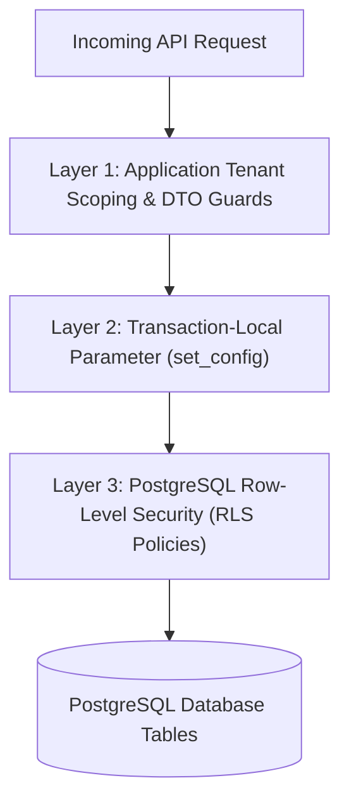

# Handloom Database Engineering Standards & Multi-Tenant Architecture (`docs/DATABASE.md`)

## 1. Executive Summary & Core Philosophy

The Handloom Operations Management Platform manages real physical textile supply chains, precious yarn inventories (silk, zari, cotton), artisan livelihoods, and financial accounting. The database architecture is built around:

1. **Strict Relational Integrity:** Enforced by PostgreSQL foreign keys, unique compound constraints, and check conditions.
2. **Deterministic Decimal Arithmetic:** Floating-point data types (`float`, `double`) are **strictly prohibited** for all monetary, quantity, weight, and dimensional values.
3. **Defense-in-Depth Multi-Tenant Isolation:** Triple-layer security combining application-level context validation, transaction-scoped parameter injection (`set_config`), and PostgreSQL Row-Level Security (RLS).
4. **Append-Only Immutable Event Ledgers:** Historical material consumption, wages, and audit logs are never modified or deleted; corrections occur through explicit reversing transactions.
5. **Horizontal Concurrency Readiness:** Stateless application connection pooling designed to scale from 1,000 to a target of 10,000 concurrent users under load.

---

## 2. Technical Stack & Prisma Package Organization

The database layer is isolated into the `@handloom/database` package within the Turborepo monorepo:

```text
packages/database/
├── prisma/
│   ├── schema.prisma                       # Centralized declarative Prisma schema
│   └── migrations/
│       ├── migration_lock.toml             # Prisma provider lockfile (postgresql)
│       └── 20261110000000_init_multi_tenant_foundation/
│           └── migration.sql               # Baseline DDL + PostgreSQL RLS policies
├── src/
│   ├── index.ts                            # Centralized PrismaClient instance & exports
│   └── tenant.ts                           # Multi-tenant context helpers & RLS wrappers
├── package.json                            # Package scripts and Prisma dependencies
└── tsconfig.json                           # TypeScript strict compiler options
```

### Dependency & Runtime Specifications

- **Database Engine:** PostgreSQL 16 (LTS).
- **ORM / Query Engine:** Prisma ORM 6.4.1.
- **Client Management:** Centralized singleton pattern in `src/index.ts` prevents connection exhaustion across hot-reloads during local development.
- **Identifier Strategy:** Universally Unique Identifiers (UUIDv4 via `@default(uuid())`) across all primary keys. Sequential auto-incrementing integers are prohibited for entity IDs.
- **Naming Conventions:**
  - Database tables: Lowercase snake_case plural (`tenants`, `users`, `audit_logs`, `sessions`).
  - Database columns: Lowercase snake_case (`tenant_id`, `created_at`, `password_hash`).
  - TypeScript models: PascalCase (`Tenant`, `User`, `AuditLog`).

---

## 3. Canonical Tenant Model Decision

### Architectural Decision: `Tenant` vs. `Organization`

The platform evaluated whether `Tenant` or `Organization` represents the canonical entity for handloom businesses:

- **Selected Canonical Entity:** **`Tenant`**
- **Rationale:**
  1. **Domain Alignment:** In the handloom ecosystem, primary weaver cooperative societies (e.g. _Kanchipuram Silk Weavers Co-op_), private spinning/weaving mills, and master weaver clusters operate as distinct legal and accounting tenants.
  2. **Codebase Consistency:** All established authentication modules, JWT claims (`tenantId`), DTOs (`register-society.dto.ts`), and TypeScript interfaces (`@handloom/types`) standardize on `tenantId`.
  3. **Multi-Tenant Clarity:** Avoids semantic confusion where an "Organization" could imply internal departments versus true data boundary separation.

### Tenant Schema Specification

```prisma
model Tenant {
  id           String       @id @default(uuid())
  name         String
  code         String       @unique /// Unique business code e.g. "KANCHI-01"
  slug         String?      @unique /// URL-friendly unique slug e.g. "kanchi-silk-weavers"
  type         TenantType   @default(COOPERATIVE)
  status       TenantStatus @default(ACTIVE)
  contactEmail String?      @map("contact_email")
  contactPhone String?      @map("contact_phone")
  address      String?
  settings     Json?        /// Tenant configuration (tax rates, standard piece wages)
  createdAt    DateTime     @default(now()) @map("created_at")
  updatedAt    DateTime     @updatedAt @map("updated_at")

  users     User[]
  auditLogs AuditLog[]

  @@index([status])
  @@index([code])
  @@index([slug])
  @@map("tenants")
}
```

---

## 4. Multi-Tenant Isolation Strategy (Defense-in-Depth)

Tenant isolation is implemented through three independent defensive perimeters:



### Layer 1: Application-Level Tenant Scoping

- All service queries explicitly inject `tenantId: user.tenantId` into Prisma `where` clauses.
- The `validateTenantOwnership(record, expectedTenantId)` helper verifies entity ownership before mutations. Any mismatched access throws `TenantIsolationViolationError`.

### Layer 2: Transaction-Scoped Context Injection

- Operations are executed inside `withTenantContext(tenantId, async (tx) => { ... })`.
- Utilizes parameterized PostgreSQL configuration parameter injection:
  ```typescript
  await tx.$executeRaw`SELECT set_config('app.current_tenant_id', ${sanitizedTenantId}, true);`;
  ```
- **Connection Pool Safety:** Setting `is_local = true` (the third argument in `set_config`) guarantees the setting is transaction-local. When the transaction commits or aborts, the parameter automatically resets, preventing session bleeding across pooled connections.

### Layer 3: PostgreSQL Row-Level Security (RLS)

- Enabled and forced on all tenant-partitioned tables in migration SQL:
  ```sql
  ALTER TABLE "users" ENABLE ROW LEVEL SECURITY;
  ALTER TABLE "users" FORCE ROW LEVEL SECURITY;

  CREATE POLICY tenant_isolation_policy ON "users"
      FOR ALL
      USING (
          current_setting('app.is_super_admin', true) = 'true'
          OR
          "tenant_id" = NULLIF(current_setting('app.current_tenant_id', true), '')::text
      )
      WITH CHECK (
          current_setting('app.is_super_admin', true) = 'true'
          OR
          "tenant_id" = NULLIF(current_setting('app.current_tenant_id', true), '')::text
      );
  ```
- **Default Deny:** If `app.current_tenant_id` is missing, `NULLIF(current_setting(..., true), '')` evaluates to `NULL`, denying access and returning 0 rows.
- **FORCE ROW LEVEL SECURITY:** Guarantees that table owners and unprivileged application roles cannot bypass policy checks.

---

## 5. Database Integrity Standards for Future Business Tables

All subsequent domain entities (Catalog, Yarn Inventory, Loom Management, Wages) must comply with these immutable integrity rules:

| Standard              | Rule & Specification                                                  | Justification                                                |
| :-------------------- | :-------------------------------------------------------------------- | :----------------------------------------------------------- |
| **Monetary Values**   | `Decimal @db.Decimal(14, 2)`                                          | Up to ₹999,999,999,999.99 with exact paise precision.        |
| **Material Weights**  | `Decimal @db.Decimal(12, 3)`                                          | Exact 1-gram (0.001 kg) precision for silk and zari control. |
| **Fabric Dimensions** | `Decimal @db.Decimal(8, 2)`                                           | Exact centimetre/inch lengths for cuts and warp sizing.      |
| **Percentages**       | `Decimal @db.Decimal(5, 2)`                                           | Up to 100.00% for wastage, moisture regain, and tolerances.  |
| **Foreign Keys**      | Explicit FKs with `onDelete: Restrict` on critical financial ledgers. | Prevents accidental cascading data deletion of audit trails. |
| **Timestamps**        | `createdAt DateTime @default(now())`, `updatedAt DateTime @updatedAt` | UTC timestamping across all operational entities.            |

---

## 6. Transaction & Concurrency Strategy

### 1. Prisma Interactive Transactions

Multi-table writes must execute atomically inside `prisma.$transaction`:

```typescript
await withTenantContext(tenantId, async (tx) => {
  // Step 1: Issue yarn from stock lot
  // Step 2: Create weaver issue transaction
  // Step 3: Append to immutable stock ledger
});
```

### 2. Concurrency & Deadlock Prevention

- **Lock Ordering:** Multi-table writes must acquire locks in alphabetical table order to eliminate cyclic deadlock dependencies.
- **Atomic Balance Updates:** Balances must be modified using atomic decrement queries rather than memory read-then-write:
  ```sql
  UPDATE yarn_lots
  SET available_kg = available_kg - :qty
  WHERE id = :id AND tenant_id = :tenantId AND available_kg >= :qty;
  ```
- **Idempotency Keys:** Critical dispatch, cut-piece acceptance, and wage disbursement requests will enforce unique idempotency keys in future mutation endpoints.

---

## 7. Indexing & Query Performance Standards

To support 1,000 to 10,000 concurrent users with sub-50ms query latencies:

1. **Tenant-Scoped Compound Indexes:** High-volume queries are scoped by tenant: `@@index([tenantId, createdAt])`, `@@unique([tenantId, code])`.
2. **Foreign Key Indexes:** Every relational column possesses an explicit index (`@@index([tenantId])`, `@@index([userId])`).
3. **Query Inspection:** Developers must analyze complex joins using PostgreSQL `EXPLAIN (ANALYZE, BUFFERS)` to verify index scans over sequential table scans.
4. **Connection Pooling:** In production, pgBouncer or AWS RDS Proxy maintains a maximum pool size of 20–50 connections per API pod.

---

## 8. Migration Management Workflow

### Migration Rules

- **Forward-Only Migrations:** Existing applied migrations must never be modified or deleted.
- **No `db push` in Production:** Production environments must strictly execute `prisma migrate deploy`.
- **Review Gate:** Every migration SQL file is inspected for locks, backward compatibility, and index creation impact before merging.

### Migration Commands

```bash
# Generate Prisma client after schema changes
pnpm --filter @handloom/database db:generate

# Apply migrations in local development
pnpm --filter @handloom/database db:migrate

# Apply migrations in staging / production (CI/CD)
pnpm --filter @handloom/database db:deploy

# Inspect database schema via Prisma Studio
pnpm --filter @handloom/database db:studio
```

---

## 9. Local & Test Setup Guide

### Local Development Setup

1. Start the PostgreSQL 16 container:
   ```bash
   pnpm docker:up
   ```
2. Run database migrations:
   ```bash
   pnpm --filter @handloom/database db:migrate
   ```
3. Generate Prisma client types:
   ```bash
   pnpm --filter @handloom/database db:generate
   ```

### Test Database Strategy

- Unit tests mock Prisma transaction interfaces and verify tenant context parameters, isolation enforcement, and ownership guards.
- Live database integration tests execute against a dedicated test database (`handloom_test_db`) created in Docker.

---

## 10. Status of Implementation & Boundaries

| Component                                                             |     Status      | Details                                                                                             |
| :-------------------------------------------------------------------- | :-------------: | :-------------------------------------------------------------------------------------------------- |
| **Prisma Schema (Tenant, User, AuditLog, Session, SystemHealth)**     | **IMPLEMENTED** | Validated schema with `slug`, compound indexes, and strict typing.                                  |
| **Initial Migration (`20261110000000_init_multi_tenant_foundation`)** | **IMPLEMENTED** | Versioned migration file containing table DDL and RLS policies.                                     |
| **Multi-Tenant Context Runner (`withTenantContext`)**                 | **IMPLEMENTED** | Parameterized `set_config` transaction-local context setter.                                        |
| **Tenant Ownership Guards (`validateTenantOwnership`)**               | **IMPLEMENTED** | Application-level cross-tenant access rejection utility.                                            |
| **Automated Isolation Unit Tests**                                    | **IMPLEMENTED** | 10 passing unit tests in `tenant-isolation.spec.ts`.                                                |
| **Live Database RLS Execution**                                       |   **BLOCKED**   | Docker Desktop is currently offline on host; live port 5432 verification pending container startup. |
| **Domain Business Tables (Inventory, Wages, Orders)**                 |   **PLANNED**   | Deferred to subsequent domain-specific tasks (Task 8.2.3 onwards).                                  |
