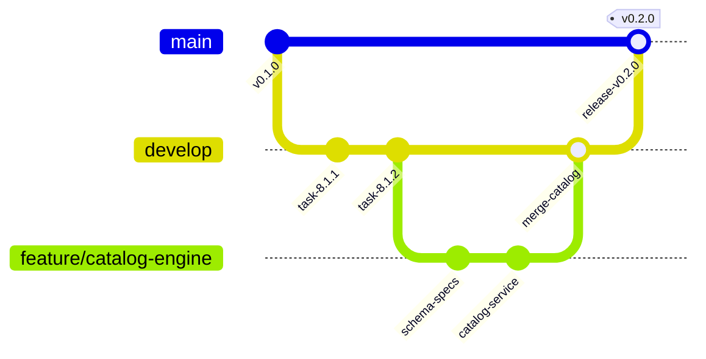

# Handloom Engineering Development & Git Workflow (docs/DEVELOPMENT_WORKFLOW.md)

## 1. The Core Engineering Rule

To guarantee verifiable quality, prevent regression, and maintain an accurate Git audit trail:

$$\textbf{ONE TASK} \longrightarrow \textbf{IMPLEMENT} \longrightarrow \textbf{TEST} \longrightarrow \textbf{REVIEW} \longrightarrow \textbf{COMMIT} \longrightarrow \textbf{PUSH} \longrightarrow \textbf{NEXT TASK}$$

Never combine multiple distinct architectural phases into an unverified mega-commit. Every milestone must be independently functional, fully tested locally, cleanly committed, and pushed upstream.

---

## 2. Branching Strategy



### Branch Roles

1. **`main`:** The production branch. Must always be deployable, with all CI checks passing.
2. **`develop`:** Integration branch for ongoing sprint tasks.
3. **`feature/<task-name>`:** Topic branches branched from `develop` for specific tasks (e.g., `feature/task-8.1.4-catalog-inventory`).
4. **`hotfix/<fix-name>`:** Emergency fixes branched directly from `main` and merged back into both `main` and `develop`.

---

## 3. Commit Message Standards (Conventional Commits)

Commit messages must follow the [Conventional Commits](https://www.conventionalcommits.org/) specification:

$$\textbf{<type>(<scope>): <short description>}$$

### Standard Types

- **`feat`:** A new user-facing or architectural feature (e.g., `feat(auth): implement refresh token rotation`).
- **`fix`:** A bug fix (e.g., `fix(api): prevent negative available_kg in yarn allocation`).
- **`docs`:** Documentation changes only (e.g., `docs: establish handloom engineering standards`).
- **`test`:** Adding or correcting unit, integration, or e2e tests (e.g., `test(e2e): add health and auth verification suites`).
- **`refactor`:** Code refactoring without altering external functionality or API contracts.
- **`chore`:** Build system, dependency updates, or configuration updates (e.g., `chore(deps): update pnpm to 11.15`).

---

## 4. Local Quality Verification Gate

Before staging any commit, developers and AI agents must run the following verification sequence:

```bash
# 1. Typecheck the entire monorepo
pnpm typecheck

# 2. Run unit and integration tests across all workspaces
pnpm test

# 3. Run live end-to-end API tests
pnpm --filter @handloom/api test:e2e

# 4. Verify production build succeeds
pnpm build
```

If any step fails, the issue must be resolved before proceeding. Never commit broken builds or failing tests.

---

## 5. Review & Git Staging Protocol

1. **Inspect Status:**
   ```bash
   git status
   ```
2. **Review Exact Line Diffs:**
   ```bash
   git diff
   ```
3. **Stage Only Intended Files:**
   Stage files specifically; never include build directories (`dist/`, `.next/`), temporary scratch files, or environment files (`.env`).
   ```bash
   git add <file1> <file2>
   ```
4. **Commit & Push:**
   ```bash
   git commit -m "docs: establish handloom engineering standards"
   git push origin main
   ```

---

## 6. Prohibited Git Actions

1. **No Force Pushing:** `git push --force` or `git push -f` is strictly prohibited on shared and primary branches (`main`, `develop`).
2. **No Secret Commits:** `.env`, private keys, and credential stores must never be added to Git.
3. **No Blind Staging:** `git add -A` or `git add .` without verifying `git status` beforehand is forbidden.

---

## 7. Rollback & Disaster Recovery Procedure

If a deployed commit introduces an unexpected production failure:

1. Do not edit history or delete remote commits.
2. Create a clean reverting commit using `git revert <commit-hash>`.
3. Verify that the rollback builds and passes tests locally.
4. Push the revert commit immediately to `main` to trigger the CI/CD deployment rollback.
