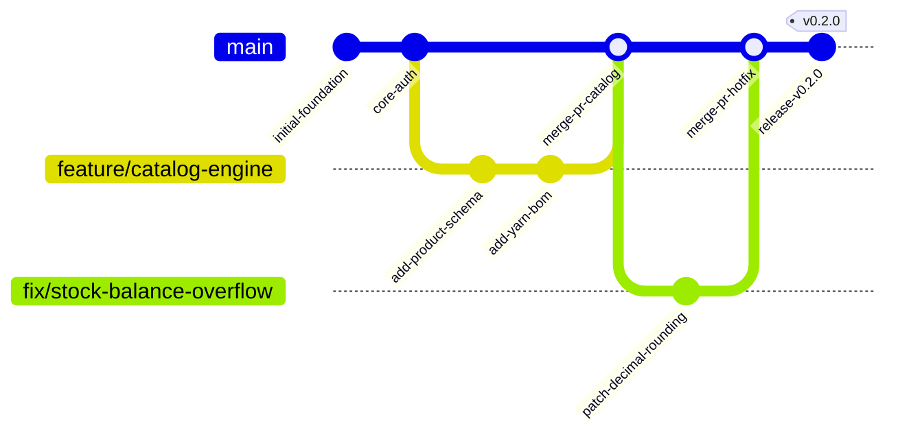
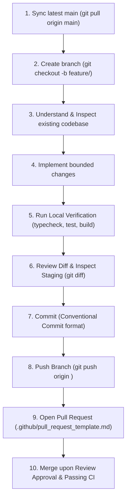

# Handloom Git Branching, Version Control & Collaboration Workflow (docs/GIT_WORKFLOW.md)

## 1. Core Version Control Philosophy

The Handloom platform manages critical physical supply chains, artisan livelihoods, and financial accounting. The Git repository is the authoritative, immutable source of engineering truth.

To guarantee stability, auditability, and production readiness, we follow the core rule:

$$\textbf{ONE TASK} \longrightarrow \textbf{BRANCH} \longrightarrow \textbf{IMPLEMENT} \longrightarrow \textbf{VERIFY} \longrightarrow \textbf{REVIEW} \longrightarrow \textbf{PR / MERGE} \longrightarrow \textbf{NEXT TASK}$$

---

## 2. Branching Strategy

Our branching model is designed to be simple, disciplined, and scalable across single contributors and expanding engineering teams. We avoid creating unnecessary permanent branches.

### Branch Taxonomy & Lifecycles

| Branch Pattern          | Scope & Purpose                                                                                                                                                        | Base Branch | Target Branch | Merging Policy                                                             |
| :---------------------- | :--------------------------------------------------------------------------------------------------------------------------------------------------------------------- | :---------- | :------------ | :------------------------------------------------------------------------- |
| **`main`**              | **Production & Release Branch:** Contains stable, verified, production-ready code. Must always compile, pass all CI checks, and be deployable.                         | N/A         | N/A           | Protected. Merged only via approved Pull Request.                          |
| **`feature/<name>`**    | **New Functional Capabilities:** Development of new business modules, UI views, or API endpoints (e.g., `feature/yarn-inventory-fifo`).                                | `main`      | `main`        | Squash and merge via PR upon passing CI and review. Deleted after merge.   |
| **`fix/<name>`**        | **Standard Bug Fixes:** Resolution of bugs, failing tests, or minor UI defects discovered during development or QA (e.g., `fix/token-rotation-null-check`).            | `main`      | `main`        | Squash and merge via PR. Deleted after merge.                              |
| **`hotfix/<name>`**     | **Urgent Production Fixes:** Emergency patches for critical production defects, data discrepancies, or security vulnerabilities (e.g., `hotfix/cve-dependency-patch`). | `main`      | `main`        | Fast-track PR review with CI gates strictly enforced. Deleted after merge. |
| **`chore/<name>`**      | **Infrastructure & Tooling:** Tooling updates, CI pipeline tweaks, linter rules, or dependency maintenance (e.g., `chore/upgrade-turborepo`).                          | `main`      | `main`        | Squash and merge via PR. Deleted after merge.                              |
| **`docs/<name>`**       | **Documentation Changes:** Updates exclusively affecting markdown documentation, guides, or specifications (e.g., `docs/git-workflow-guide`).                          | `main`      | `main`        | Squash and merge via PR. Deleted after merge.                              |
| **`release/<version>`** | **Release Hardening (Optional):** Version bump, changelog generation, and final smoke-testing prior to tagging production releases (e.g., `release/v0.2.0`).           | `main`      | `main`        | Rebase or merge commit with production release tag. Deleted after merge.   |

---

## 3. Conventional Commit Standards

Every commit in this repository must follow the [Conventional Commits](https://www.conventionalcommits.org/en/v1.0.0/) specification:

$$\textbf{<type>(<scope>): <subject>}$$

### Allowed Commit Types

- **`feat`:** A new business or technical capability (e.g., `feat(catalog): add reed and pick density calculations`).
- **`fix`:** A bug fix or patch (e.g., `fix(inventory): prevent race condition during yarn lot allocation`).
- **`chore`:** Build configuration, tooling, or dependency updates (e.g., `chore(deps): update pnpm to 11.15`).
- **`docs`:** Documentation additions or corrections (e.g., `docs(api): document idempotency header usage`).
- **`test`:** Adding or updating test suites (e.g., `test(e2e): add cut-piece inspection grading tests`).
- **`refactor`:** Code refactoring without altering external API contracts or business behavior.
- **`perf`:** Performance optimizations (e.g., `perf(database): add composite index on tenant_id and status`).
- **`style`:** Code formatting, whitespace, or style corrections without logic modifications.

### Standard Scopes

- Domain Scopes: `auth`, `catalog`, `inventory`, `pre-loom`, `production`, `quality`, `wages`, `orders`, `ai`.
- Architectural Scopes: `api`, `web`, `database`, `types`, `logger`, `config`, `infra`, `git`.

### Atomic Commit Principles

1. **Single Logical Change:** Each commit should represent one self-contained, indivisible unit of work. Do not bundle unrelated refactoring with feature code.
2. **Always Compilable:** Never commit intermediate code that breaks TypeScript compilation or causes tests to fail.
3. **Imperative Mood:** Use present tense imperative verbs in the subject ("add", "fix", "update", not "added" or "fixing").

### Examples: Good vs. Bad Commits

| Status   | Commit Message                                                          | Rationale                                                                       |
| :------- | :---------------------------------------------------------------------- | :------------------------------------------------------------------------------ |
| **GOOD** | `feat(inventory): implement fifo yarn lot allocation algorithm`         | Clear type, domain scope, and concise imperative description.                   |
| **GOOD** | `fix(auth): revoke session family upon replay of expired refresh token` | Explicit security fix with clear causal context.                                |
| **GOOD** | `docs(database): document decimal numeric precision standards`          | Accurately describes documentation addition.                                    |
| **BAD**  | `WIP`                                                                   | Meaningless; provides zero context in git history.                              |
| **BAD**  | `fixed some bugs and updated files`                                     | Vague, combines multiple changes, lacks type and scope.                         |
| **BAD**  | `feat: added stuff for wages and also changed tailwind`                 | Violates atomic commit rule; mixes frontend styling with financial domain code. |

---

## 4. The 10-Step Development Workflow

All contributors and AI coding assistants must adhere to this sequential lifecycle:

### Solo-Development Direct-Push Policy (Exception Protocol)

In early bootstrapping phases where a single core maintainer develops bounded architectural milestones:

- Direct commits to `main` are permissible **only if**:
  1. The change is a bounded, single-task milestone.
  2. All local verification gates (`pnpm typecheck`, `pnpm test`, `pnpm build`) pass with 0 errors.
  3. The working tree is fully reviewed with `git diff`.
  4. Force pushing (`git push -f`) is **strictly prohibited**.
- For all collaborative work, production deployments, and multi-contributor features, the standard PR workflow is mandatory.

---

## 5. Pull Request Standards & Governance

Pull requests provide the collaborative gate ensuring architectural consistency, security, and test coverage before code enters `main`.

### PR Requirements

1. **Mandatory Template:** Every pull request must use the standardized template at [`.github/pull_request_template.md`](../.github/pull_request_template.md).
2. **Passing CI Pipeline:** The automated GitHub Actions CI workflow (`.github/workflows/ci.yml`) must pass completely (typecheck, unit tests, and monorepo build).
3. **Peer Review Approval:** At least one independent review approval is required prior to merge when operating in team mode.
4. **Conversation Resolution:** All reviewer comments, security inquiries, and suggestions must be explicitly resolved before merging.
5. **No Broken Windows:** Never merge a PR with failing tests or skipped TypeScript errors.

### Merge Strategy

- **Default Strategy:** **Squash and Merge**.
- **Rationale:** Combines multiple iterative feature commits into a single, clean, atomic commit on `main` that matches the PR title and conventional commit format. This preserves a pristine, readable linear Git history.

---

## 6. Protected-Branch Configuration for `main`

The `main` branch represents production-ready software and must be protected against accidental deletion, forced overwrites, and unvetted commits.

### Recommended GitHub Branch Protection Settings

Repository owners and organization administrators must configure the following rules in **GitHub Repository Settings &rarr; Branches &rarr; Branch protection rules &rarr; Add rule for `main`**:

- [x] **Require a pull request before merging:**
  - _Require approvals:_ Minimum 1 approval.
  - _Dismiss stale pull request approvals when new commits are pushed:_ Checked.
  - _Require review from Code Owners:_ Checked (when `CODEOWNERS` is configured).
- [x] **Require status checks to pass before merging:**
  - _Require branches to be up to date before merging:_ Checked.
  - _Status check:_ `ci / Handloom Monorepo CI Pipeline (pnpm typecheck, test, build)`.
- [x] **Require conversation resolution before merging:** Checked.
- [x] **Require signed commits:** Recommended for production cryptographic non-repudiation.
- [x] **Do not allow bypassing the above settings:** Checked (applies to administrators).
- [x] **Restrict force pushes:** Strictly enabled (prevents `git push --force`).
- [x] **Restrict deletions:** Strictly enabled (prevents `git branch -D main`).

> **Status Note:** Branch protection settings are enforced at the GitHub repository hosting layer. The configuration rules documented above represent the required organizational policy and must be enabled via the GitHub repository web console by the repository administrator (`Vendhan1512`).

---

## 7. Repository Safety & Security Rules

1. **Zero Secret Tolerance:**
   - Never commit `.env` files, production database connection strings, JWT secrets, or cloud API credentials.
   - All environment variables must be declared with sanitized mock values in `.env.example`.
2. **Never Rewrite Shared History:**
   - Commands that rewrite public history (`git rebase -i`, `git commit --amend`, `git filter-branch`) must never be pushed to `main` or shared remote branches.
3. **No Force Pushing:**
   - `git push --force` and `git push -f` are strictly forbidden. If an error occurs, create a forward-only compensating commit or use `git revert`.
4. **No Build Artifacts in Git:**
   - Directories such as `dist/`, `.next/`, `coverage/`, `.turbo/`, and `node_modules/` must remain in `.gitignore`.
5. **Never Delete Unmerged Work:**
   - Always ensure a branch has been merged into `main` before deleting it locally or remotely.
