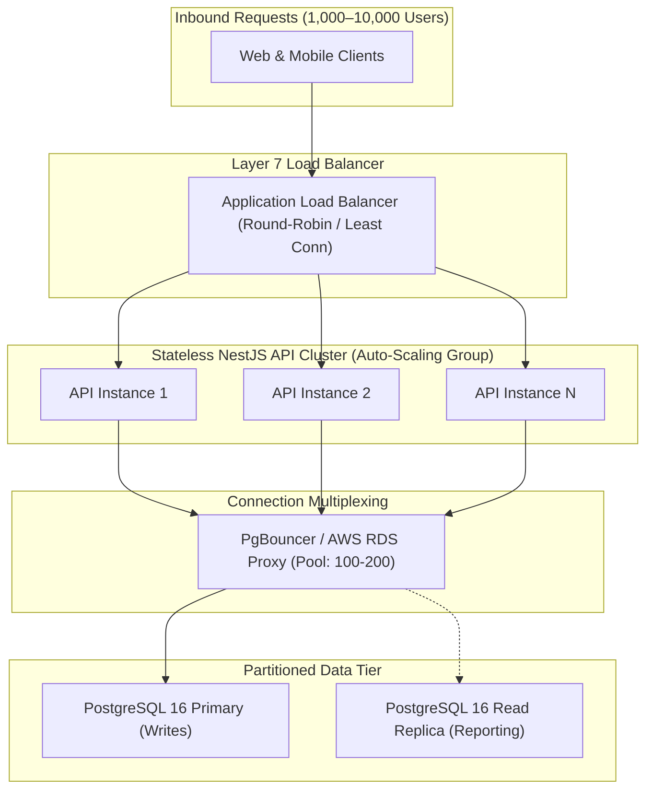

# Handloom Scalability Architecture & Performance Engineering (docs/SCALABILITY.md)

## 1. Concurrency Objectives & Capacity Targets

The Handloom platform is architecturally engineered to support **1,000 to 10,000 concurrent active users** (supervisors recording daily cuts, accountants approving wage batches, weavers checking piece status, and inspectors grading yardage).

> **Architectural Disclaimer:** Concurrency capacity is an engineering target that requires measured empirical verification. Capacity cannot be claimed as achieved without load test benchmarks executed under realistic network latency and transaction contention.

---

## 2. Performance Metrics & Service Level Objectives (SLOs)

| Metric                          | Target (1,000 Concurrent Users) | Target (10,000 Concurrent Users) | Measurement Method          |
| :------------------------------ | :------------------------------ | :------------------------------- | :-------------------------- |
| **API Response Latency (p50)**  | $< 50\text{ ms}$                | $< 80\text{ ms}$                 | APM Tracing (OpenTelemetry) |
| **API Response Latency (p95)**  | $< 150\text{ ms}$               | $< 250\text{ ms}$                | APM Tracing                 |
| **API Response Latency (p99)**  | $< 350\text{ ms}$               | $< 500\text{ ms}$                | APM Tracing                 |
| **Throughput (Requests/sec)**   | $500\text{ RPS}$                | $3,500\text{ RPS}$               | Load test runner (k6)       |
| **Error Rate (5xx)**            | $< 0.01\%$                      | $< 0.05\%$                       | API Gateway metrics         |
| **Database CPU Utilization**    | $< 65\%$ peak                   | $< 75\%$ peak                    | CloudWatch / Grafana        |
| **Queue Processing Delay**      | $< 2\text{ seconds}$            | $< 5\text{ seconds}$             | BullMQ queue metrics        |
| **Concurrent Write Contention** | $< 0.1\%$ 409 Conflict          | $< 0.5\%$ 409 Conflict           | API logs                    |

---

## 3. Stateless Application Tier & Horizontal Scaling

### Architectural Principles for Horizontal Scale

1. **Stateless API Replicas:** NestJS instances do not hold local session state, WebSocket user registries, or cached memory state that cannot be reconstructed from Redis or PostgreSQL.
2. **Auto-Scaling Triggers:** Compute nodes scale out horizontally based on CPU utilization (> 70%) and average HTTP response latency (> 200ms over 2 consecutive minutes).
3. **Graceful Shutdown:** All API instances implement `app.enableShutdownHooks()` to finish active in-flight requests during rolling deployments without dropping client connections.

---

## 4. Database Connection Pooling & Query Optimization

A major bottleneck at 10,000 concurrent users is PostgreSQL process limits. PostgreSQL spawns a separate OS process per direct connection, resulting in memory exhaustion if 5,000 direct connections are opened.

### Solution: Connection Pooling Architecture

- **Pooler:** PgBouncer or AWS RDS Proxy deployed in `transaction` pooling mode.
- **Client Side (Prisma):** Configured with connection limits matching instance count (`connection_limit = 20` per container).
- **Server Side:** Multiplexes thousands of client connections into a tight, warm pool of 100 to 200 physical PostgreSQL backend connections.

### Query Optimization Rules

- **No N+1 Queries:** Eagerly load child relations via Prisma `include` or explicit joined queries.
- **Strict Pagination:** Unbounded queries (`findMany()` without `take` and `skip`) are strictly forbidden. Default page limit is 20; hard maximum is 100.
- **Selective Projections:** Use Prisma `select` blocks to fetch only required columns, avoiding high-overhead JSON and text transfers on collection listings.

---

## 5. Caching & Background Queues (PLANNED)

### Multi-Tiered Caching

1. **HTTP Caching:** Static assets, fabric design thumbnails, and public catalog listings utilize HTTP `Cache-Control: public, max-age=3600, stale-while-revalidate=86400`.
2. **Distributed Redis Cache:** Cached query results for tenant configuration, master reed/pick standards, and product BOMs using the cache-aside pattern with TTLs (15–60 minutes).

### Background Queue Processing

- **Queue Engine:** BullMQ running over Redis 7.
- **Worker Isolation:** Heavy background compute tasks (bulk weekly wage batch computations, PDF payslip compilation, AI document OCR parsing) execute in dedicated worker processes separate from the web API cluster.
- **Backoff & Retries:** Tasks configure exponential backoff (3 attempts). Failed tasks move to a Dead-Letter Queue (DLQ) for alerting and manual replay.

---

## 6. Load & Stress Testing Framework

Prior to production releases, the platform must undergo rigorous performance validation:

1. **k6 Load Tests:**
   - **Baseline Test:** 500 virtual users (VUs) maintaining steady throughput for 15 minutes.
   - **Stress Test:** Ramping from 1,000 to 5,000 VUs over 30 minutes to detect memory leaks and connection pool starvation.
   - **Spike Test:** Sudden traffic surge from 100 to 3,000 VUs within 60 seconds (simulating morning depot cut-piece check-ins).
2. **Hot-Row Contention Scenarios:**
   - Simulating 200 concurrent requests attempting to allocate material from the same `YarnLot` to verify atomic conditional updates and absence of deadlocks.
