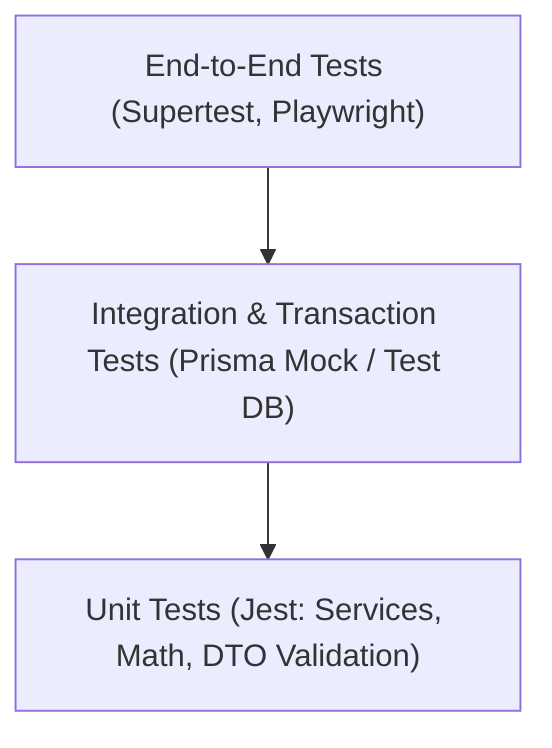

# Handloom Quality Assurance & Testing Engineering Standards (docs/TESTING.md)

## 1. Testing Philosophy & Test Pyramid

Testing in the Handloom platform guarantees that business calculations (reed/pick thread counts, yarn loss allowances, piece-rate wages, advance deductions) and security boundaries (multi-tenant isolation, RBAC) are verified through automated, reproducible code.

---

## 2. Testing Tiers & Scope

### Tier 1: Unit Tests

- **Framework:** Jest (`ts-jest`).
- **Scope:** Individual services, utility functions, mathematical formulas, and DTO transformation logic.
- **Isolation:** Dependencies (Prisma, Logger, External HTTP) are mocked using Jest spies or mock fixtures.
- **Coverage Goal:** Minimum 85% branch coverage on domain business calculation logic.
- **Execution:** `pnpm test` (or package-scoped: `pnpm --filter @handloom/api test`).

### Tier 2: Integration & Database Transaction Tests

- **Scope:** Validates multi-step database transactions (e.g., deducting yarn lot stock while simultaneously creating an immutable `YarnStockLedger` record).
- **Verification:** Ensures that if any step within a transaction throws an error, all associated writes roll back completely without partial state persistence.

### Tier 3: API & Authorization Tests (End-to-End)

- **Framework:** Supertest (`supertest`).
- **Configuration:** `apps/api/test/jest-e2e.json` executing `apps/api/test/app.e2e-spec.ts`.
- **Scope:** Live NestJS application pipeline:
  - Global `ValidationPipe` payload rejection (`whitelist`, `forbidNonWhitelisted`).
  - Global `HttpExceptionFilter` error envelope formatting.
  - Global `TransformInterceptor` success envelope formatting.
  - Role-Based Access Control (`RolesGuard`) returning `403 Forbidden` for unauthorized roles.
  - Unauthenticated access returning `401 Unauthorized`.
- **Execution:** `pnpm --filter @handloom/api test:e2e`.

### Tier 4: Multi-Tenant Isolation Tests

- **Scope:** Explicit tests verifying that Tenant B cannot access, read, update, or enumerate records belonging to Tenant A, even when passing valid IDs.
- **Verification:** Both application-level (`where: { tenantId }`) and database-level (Row-Level Security) isolation must be asserted.

### Tier 5: Concurrency & Stress Tests (PLANNED)

- **Framework:** k6.
- **Scope:** Hot-row yarn lot allocation and cut-piece check-in under high concurrent virtual user loads (500–5,000 VUs).

---

## 3. Feature Completion Checklist

Before any business module or feature branch is declared complete and ready for pull request merge, the following checklist must be satisfied:

- [ ] **Type Safety:** `pnpm typecheck` exits with code 0 across all 6 workspaces.
- [ ] **Unit Tests Written & Passing:** All service methods have corresponding `.spec.ts` suites covering both happy path and failure edge cases.
- [ ] **Validation Tested:** Invalid input payloads (empty bodies, invalid emails, negative numbers) assert `400 Bad Request`.
- [ ] **Authorization Tested:** Route permissions assert `401 Unauthorized` for missing tokens and `403 Forbidden` for unauthorized roles.
- [ ] **Tenant Isolation Verified:** Scoping queries explicitly filter by `tenantId`.
- [ ] **Atomic Transactions:** Multi-entity mutations are wrapped in `prisma.$transaction`.
- [ ] **Audit Trail Logged:** Crucial state changes emit structured audit logs to the `audit_logs` table.
- [ ] **Full Monorepo Build:** `pnpm build` completes with exit code 0.
- [ ] **End-to-End Tests Passing:** `pnpm --filter @handloom/api test:e2e` passes 100%.
- [ ] **Clean Git Working Tree:** All modifications reviewed with `git diff` and committed using Conventional Commits.
